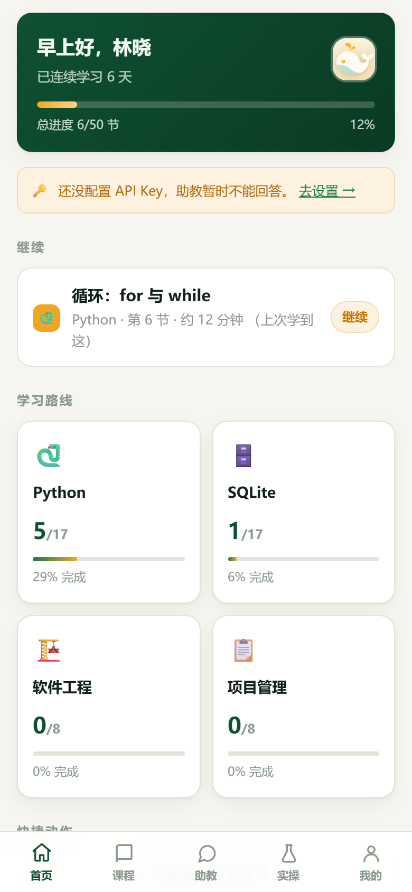
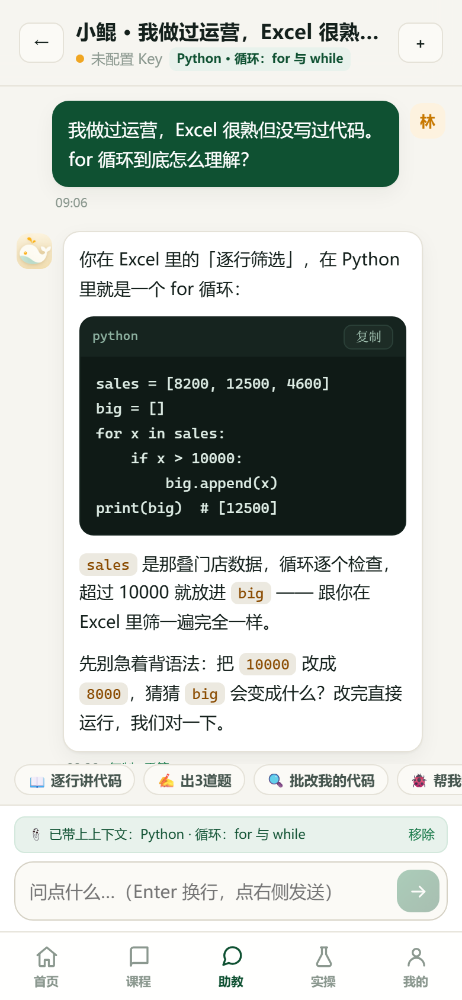
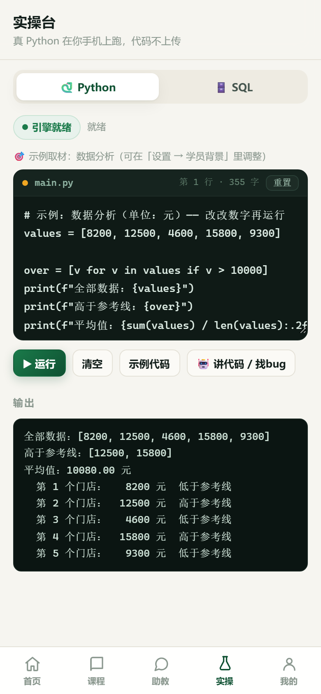
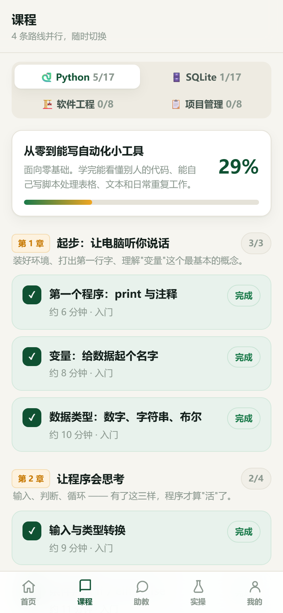
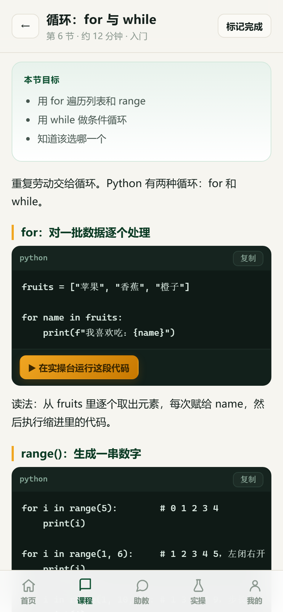

<div align="center">


<h1>小坤学编程</h1>

<p><strong>手机上的 AI 编程私教。代码在手机上真跑，模型用你自己的 Key，课程和人设可以整个换掉。</strong></p>

<p>Python / SQLite 各 17 节 · 本地执行 · 0 后端 · 离线优先 · PWA + Android</p>

<p>
  <a href="https://github.com/111aligiant/xiaokun-learn/actions/workflows/ci.yml"></a>
  <a href="./LICENSE"></a>
  <a href="./public/manifest.webmanifest"></a>
  <a href="https://github.com/111aligiant/xiaokun-learn/releases/latest"></a>
  
</p>

<p>
  <a href="https://111aligiant.github.io/xiaokun-learn/"><strong>在线体验</strong></a> ·
  <a href="https://github.com/111aligiant/xiaokun-learn/releases/latest">下载 Android APK</a> ·
  <a href="./docs/course-pack.md">课程包格式</a> ·
  <a href="#english">English</a>
</p>

</div>

<div align="center">



</div>

> 截图为演示数据。应用本身不含任何预置账号或 API Key。

---

## 它和「用 AI 学编程」的常见做法有什么不同

| | 通用聊天 AI | 视频课 / 刷题 App | 小坤学编程 |
| --- | --- | --- | --- |
| 代码在哪运行 | 只给文本，报错靠猜 | 平台沙箱，离开就没了 | **手机本地** CPython / SQLite，真跑真报错 |
| 是否记得你 | 每次重新交代背景 | 千人一面 | **学员画像**常驻每一轮对话 |
| 学习闭环 | 你问它答 | 固定目录，缺少追问 | 17 节路线 + 进度 + 笔记 + 随时追问 |
| 成本 | 订阅 | 订阅 | **0 后端**，只付模型 API 用量 |
| 能否改成自己的 | 不能 | 不能 | **人设、画像、课程**都是普通 JS 数据 |

一句话：它不是套壳聊天框，而是把「因材施教」拆成了可配置的三层，再配上一个真的能跑代码的实操台。

---

## 四个亮点

### 1. 真环境：代码在你的手机上执行

- Python 用 **Pyodide**（CPython/WASM），SQL 用 **sql.js**（SQLite/WASM），不需要服务器
- 课程里的代码块可以一键送进实操台，改一行马上看结果
- 报错信息是真的，调试过程也是真的；代码不上传
- 手机上竖屏写代码、点「运行」、看输出，界面就是为这个流程设计的

### 2. 真私教：先懂你，再讲课

- **3 步摸底**：称呼、目标、基础、每周时间、举例领域
- **分层提示词**：人设（稳定）→ 学员背景（半静态）→ 当前课程（动态），稳定段在前，方便模型侧上下文缓存
- **三种人设**：严谨私教 / 陪练搭子 / 面试官，可自行增删
- **会话隔离**：每段对话有自己的上下文，换话题不串台，历史随时切回
- **不给答案，先问思路**：写进人设约束，避免变成「代写作业机」

### 3. 真省钱：0 后端，自带模型

- 没有服务器、账号、数据库要维护
- 支持任意 **OpenAI 兼容平台**：DeepSeek / OpenAI / 通义千问 / 智谱 GLM / Kimi / 硅基流动，内置快捷填充
- Key、base_url、模型名三项都可手填，随时换平台
- 只有你主动提问时才联网；课程、进度、笔记、对话全部离线
- API Key 只存本机 localStorage；导出的备份 JSON **不包含** Key

### 4. 真模板：换个学科就能用

- 换人设：`src/data/persona.js`
- 换学员字段：`src/data/profile.js`
- 加课程：在 `src/data/courses.js` 注册一条路线
- 自带课程包校验 CLI、提示词单测、Playwright E2E 和 GitHub Actions
- 同一套代码可发网页（PWA）、可打 Android APK

---

## 界面

| 课程列表 | 课时与练习 |
| --- | --- |
|  |  |

底部五个入口：首页 / 课程 / 助教 / 实操 / 我的。首页会记住你上次学到哪，助教对话里可以直接出题、批改、找 bug。

---

## 30 秒上手

### 直接体验

- **网页版**：<https://111aligiant.github.io/xiaokun-learn/>（可加到手机桌面，像 App 一样用）
- **Android**：到 [Releases](https://github.com/111aligiant/xiaokun-learn/releases) 下载最新 APK

### 本地跑起来

需要 Node.js 20+（CI 使用 Node 22）。

```bash
git clone https://github.com/111aligiant/xiaokun-learn.git
cd xiaokun-learn
npm install
npm run dev
```

打开终端里打印的地址，首次进入会走 3 步引导。

### 接上模型

底部「我的 → 模型接入」，填 API Key、base_url 和模型名。

默认 `https://api.deepseek.com` + `deepseek-chat`，也可以点预设一键切换平台。三者都可自由替换，不绑定任何一家。

### 打包

```bash
npm run build      # 网页版 → dist/
npm run cap:sync   # 构建并同步到 Android 工程
npm run apk        # debug APK → android/app/build/outputs/apk/debug/app-debug.apk
```

打包 Android 需要 JDK 21 与 Android SDK；只想跑网页版可以忽略 `android/`。

Release 里的 APK 是 debug 签名，只适合自己安装体验；正式分发请自行生成签名密钥并配置 release 构建。

---

## 适合谁

- **自学编程的人**：每天 10 分钟，跟着 17 节路线走，卡住随时问，不用在教程、搜索和编辑器之间来回切
- **家长 / 老师**：给一个具体的孩子或学生配专属助教，它会记得基础、目标和每周能投入的时间
- **做 AI 教育产品的人**：fork 成英语、数学、考证……任何具备「讲解 + 练习 + 反馈」结构的学科，不用从零搭脚手架

---

## 为什么会有这个项目

它最初是一个只服务一位学员的私教版：学员画像写死在代码里，例子全来自学员自己的行业。做完之后发现，真正稀缺的不是「再做一个聊天框」，而是把「因材施教」变成可以配置的东西。

于是有了这个模板：默认助教叫「小坤」，但名字、语气、学员背景和课程都可以换。你拿到的是一个能直接用的 App，也是一份可以拆开改的教学结构。

---

## 把它改成你自己的 App

定制点都在 `src/data/` 和少量配置里，不需要动视图层。

### 1. 换助教人设

`src/data/persona.js`

```js
export const PERSONA_PRESETS = {
  tutor: {
    id: 'tutor',
    label: '严谨私教',
    short: '先探底，一次只讲一个概念',
    role: '一位专精 Python 与 SQLite 的私人编程教练',
    voice: '直接、务实、有耐心但不绕弯子。',
    emphasis: ['每个概念配一个「坑」', '结束必留钩子'],
    boundaries: [],
  },
  // 加自己的预设…
}
```

提示词会按「人设 → 学员背景 → 水平 → 当前课程」的顺序拼装，见 `src/data/prompts.js`。

### 2. 换学员背景字段

`src/data/profile.js` 定义字段、举例领域与渲染方式。
`ProfileWizard.vue` 与 `Settings.vue` 会自动读取这些常量；如果新增字段，需要在向导里补一个输入项。

举例领域支持预设（AI 应用、数据分析、办公自动化、后端/数据库等），也可以自由填写；留空时会明确告诉模型「别猜」。

### 3. 换课程

课程是普通 JS 数据，结构见 `src/data/python-course.js`，完整字段说明见 [docs/course-pack.md](./docs/course-pack.md)。

新增一条路线只需在 `src/data/courses.js` 的 `TRACKS` 里注册：

```js
{
  id: 'data',
  name: 'Python 数据分析',
  icon: 'Py',
  lang: 'python',     // 复用哪个实操台运行时：python | sql
  extension: 'py',
  course: DATA_COURSE,
  lessons: DATA_LESSONS,
}
```

`Home.vue` / `Learn.vue` / `Lesson.vue` 会自动读取注册表。
`lang` 目前只有 `python` 和 `sql` 两个运行时；接新语言需要在 `src/runtime/` 里补适配层。

课程写完后跑：

```bash
npm run validate:course
```

会按 P0/P1/P2 分级报告结构问题。

### 4. 换名字与品牌

用户可见名称在三处：

- `index.html` 的 `<title>` 与 description
- `public/manifest.webmanifest` 的 `name` / `short_name`
- `capacitor.config.json` 的 `appName`（改完跑一次 `npx cap sync android`）

助教默认名在 `src/store/app.js` 的 `DEFAULT_SETTINGS.assistantName`。
版本号只在 `package.json` 里改，界面通过 Vite 注入。

> 内部标识保留历史命名：localStorage key `xiaokun.state.v1`、Android namespace `com.xiaokun.learn`、applicationId `com.xiaokun.learn.v2`、repo 目录名 `xiaokun-learn`。
> 改 localStorage key 和 applicationId 会让老用户丢数据或无法覆盖安装，模板默认不动。

---

## 技术栈

| 层 | 选型 |
| --- | --- |
| 界面 | Vue 3 + Vue Router，原生 CSS |
| 构建 | Vite 6 |
| 移动端 | Capacitor 7（Android） |
| Python 运行时 | Pyodide（CPython/WASM） |
| SQL 运行时 | sql.js（SQLite/WASM） |
| 模型调用 | OpenAI 兼容 Chat Completions（流式） |
| 本地存储 | localStorage |
| CI/CD | GitHub Actions（CI / Pages / APK） |

---

## 项目结构

```
xiaokun-learn/
├─ src/
│  ├─ views/           Home / Learn / Lesson / Chat / Lab / Settings
│  ├─ components/      MarkdownLite · ContentBlocks · CodeEditor · ProfileWizard
│  ├─ data/            courses（注册表）· python/sql-course · persona · profile · prompts
│  ├─ runtime/         Pyodide / sql.js 封装
│  ├─ api/llm.js       OpenAI 兼容流式调用
│  └─ store/           app.js（设置/进度/会话）· lab-bus.js（跨页跳转）
├─ public/             Pyodide、sql.js、PWA manifest、Service Worker
├─ android/            Capacitor 原生工程
├─ docs/               课程包格式、界面截图
├─ scripts/            Playwright 专项测试、课程包校验
└─ .github/workflows/  CI / GitHub Pages / APK
```

---

## 部署与自动化

仓库自带三个 GitHub Actions：

| 工作流 | 触发 | 作用 |
| --- | --- | --- |
| `ci.yml` | push / PR | 课程包校验、提示词单测、构建、Playwright E2E |
| `pages.yml` | push 到 main | 构建并发布到 GitHub Pages |
| `android.yml` | 手动 / `v*` tag | 构建 debug APK 并上传为 artifact |

使用 Pages 前，在仓库 **Settings → Pages → Source** 选择 **GitHub Actions**。
`vite.config.js` 的 `base: './'` 保证子路径部署（`https://user.github.io/repo/`）可用。

PWA：`public/sw.js` 会缓存同源静态资源，断网时导航回退到缓存的 `index.html`。
模型 API 是跨域请求，不会被缓存。更新静态资源后如需强制刷新缓存，修改 `sw.js` 里的 `CACHE` 版本号。

---

## 测试

数据与提示词单测：

```bash
npm run test:qa
```

课程包结构校验：

```bash
npm run validate:course
```

E2E 用 Playwright，跑在构建产物上：

```bash
npm i -D playwright
npx playwright install chromium

npm run build
npm run preview            # 另开一个终端保持运行
npm run test:e2e
```

- `session-test`：新建 / 切换 / 删除 / 持久化
- `session-isolation-test`：新对话不承接旧消息与旧课程上下文
- `profile-persona-test`：首次引导、画像写入、提示词组装、设置页编辑、备份脱敏

如果 Playwright 装在项目外（例如共享工作区），用环境变量指过去：

```bash
PLAYWRIGHT_NODE_MODULES=/path/to/node_modules npm run test:e2e
```

---

## 隐私与数据

- API Key 只存本机 localStorage，不经过任何中转服务器
- 导出的备份 JSON **不包含** API Key；导入时沿用本机已有的 Key
- 课程、进度、笔记、对话全部离线
- 代码在设备本地执行（Pyodide / sql.js），不上传
- 只有你主动发送给助教的内容会发往你配置的模型服务

---

## 已知限制

- 首次加载 Python 运行时约 10MB；`pandas`、`openpyxl` 等第三方包在手机端装不了
- SQL 实操台跑的是内存 SQLite，数据随会话重置；真实项目用 Python 的 `sqlite3` 写 `.db` 文件（第 17 节有完整流程）
- 无后端：数据换设备需手动导出 / 导入
- 界面目前只有简体中文

---

## 参与贡献

欢迎提 Issue 和 PR，尤其是这些方向：

- 新的课程包（其他学科 / 其他语言）
- 新人设预设与更好的提示词
- 英文界面与文档
- iOS 适配、更多运行时

1. Fork 本仓库并新建分支
2. 修改后本地跑 `npm run validate:course && npm run test:qa`
3. 提交 PR，说明改了什么、为什么改

提交前请确认没有把 API Key、个人学习数据或 `.env` 文件带进仓库。

如果这个项目帮你省下了一次翻教程的时间，点个 **Star** 就是最好的支持。

---

## English

**Xiaokun Learn** is a phone-first AI coding tutor that runs **real Python (Pyodide)** and **SQL (SQLite)** locally on your device. Bring your own OpenAI-compatible API key — there is no backend, no account, and no server cost.

Courses, persona, and the learner profile are plain JS data, so you can fork it into a tutor for any subject with a cycle of explain → practice → feedback. Ships as a PWA and an Android app via Capacitor.

> The UI is currently Simplified Chinese.

[Live demo](https://111aligiant.github.io/xiaokun-learn/) · [Download APK](https://github.com/111aligiant/xiaokun-learn/releases/latest) · [Course pack format](./docs/course-pack.md)

---

## 致谢

[Vue 3](https://vuejs.org/) · [Vite](https://vitejs.dev/) · [Capacitor](https://capacitorjs.com/) · [Pyodide](https://pyodide.org/) · [sql.js](https://github.com/sql-js/sql.js) · [DeepSeek](https://www.deepseek.com/)

## License

[MIT](./LICENSE)
